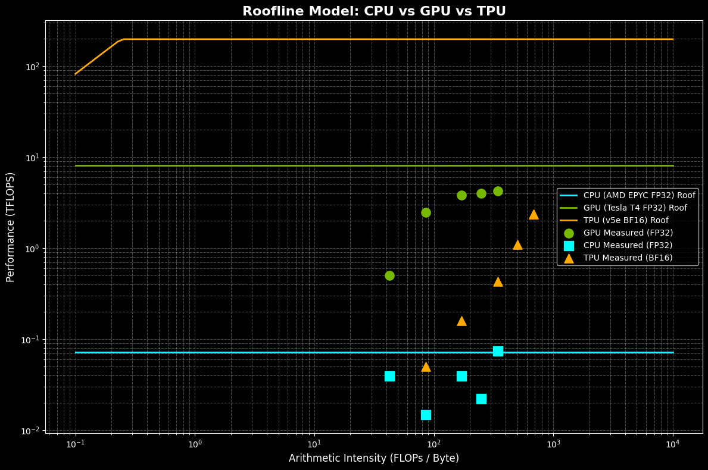
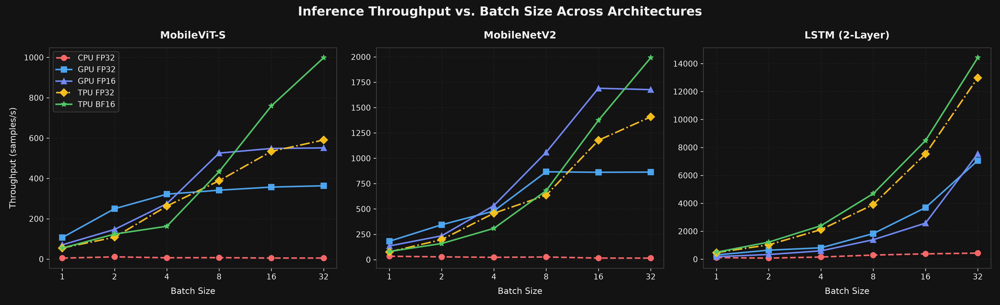
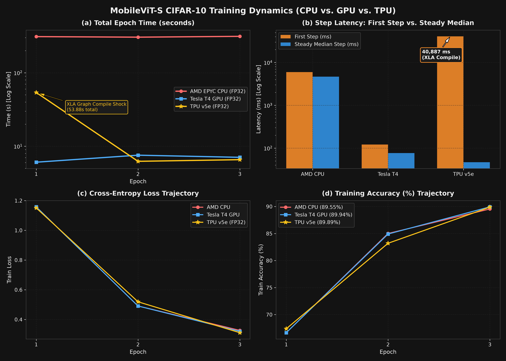
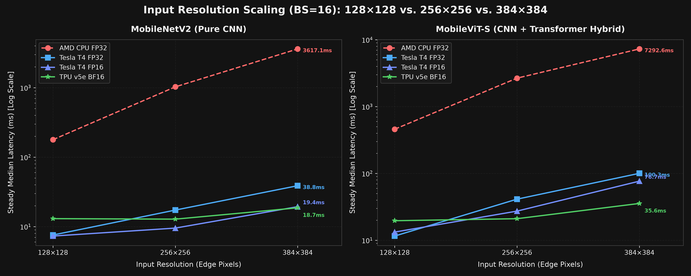
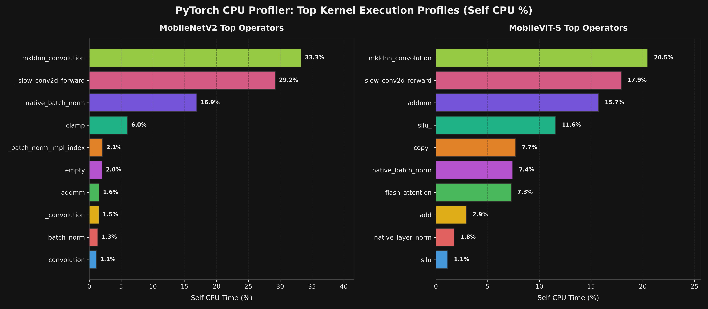
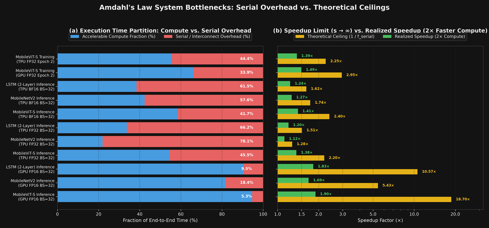

# Comparative Hardware Architecture Benchmark Report: CPU vs. GPU vs. TPU in Modern Deep Learning Workloads

**Author:** Muhammad Ahmad (24F-0807)  
**Affiliation:** FAST National University of Computer and Emerging Sciences, Chiniot-Faisalabad Campus  
**Course:** Advanced Computer Architecture / AI Accelerators  
**Date:** November 2026  

---

## Executive Summary

This empirical investigation provides a rigorous architectural evaluation of three fundamentally distinct computing paradigms executing deep learning workloads: a general-purpose host microprocessor (**AMD EPYC 7B12 CPU**), a massively parallel SIMT streaming accelerator (**NVIDIA Tesla T4 GPU**), and a domain-specific systolic tensor accelerator (**Google Cloud TPU v5e**). 

Using three representative neural workloads spanning computer vision and sequence processing—**MobileViT-S** (hybrid convolution-attention vision transformer), **MobileNetV2** (depthwise separable convolutional network), and a **2-Layer LSTM** (recurrent sequence architecture)—we examine compute density, memory hierarchies, arithmetic intensity, numerical precision, compile-time overheads, tail latency stability, and end-to-end scaling boundaries governed by Amdahl's Law.

All empirical metrics reported herein were gathered under systematic, reproducible microbenchmarking sweeps and cross-validated against raw telemetry stored in `data/`.

---

## 1. Hardware Architecture & Empirical Roofline Model

### 1.1 Microarchitectural Specifications

The three benchmarked execution targets embody divergent design philosophies across compute units, memory technologies, and interconnect fabrics:

| Architectural Metric | AMD EPYC 7B12 (Host CPU) | NVIDIA Tesla T4 (SIMT GPU) | Google Cloud TPU v5e (Systolic TPU) |
| :--- | :--- | :--- | :--- |
| **Compute Units** | 1 Physical Core (2 vCPUs allocated) | 40 Turing SMs (2,560 CUDA Cores, 320 Tensor Cores) | 4 × (128×128) MXUs (65,536 ALUs total) |
| **Instruction Architecture** | Out-of-order superscalar x86-64 + AVX2 (256-bit FMA) | Single Instruction Multiple Threads (SIMT) + Warp Schedulers | Static 2D Systolic Array (VLIW / Matrix Co-processor) |
| **Peak FP32 Compute** | 0.072 TFLOPS (72.0 GFLOPS theoretical peak; empirical peak 74.55 GFLOPS) | 8.14 TFLOPS (FP32 Core Peak) | Standard FP32 converted/accumulated in MXU pipelines |
| **Peak Low-Precision** | 288 GOPS (0.288 TOPS INT8 peak) | 65.00 TFLOPS (FP16 Tensor Core) / 130.00 TOPS (INT8) | 197.00 TFLOPS (BF16 Peak) / 393.00 TOPS (INT8 Peak) |
| **Memory Architecture** | DDR4-3200 (System RAM, UMA) | 16 GB GDDR6 (Discrete VRAM) | 16 GB High Bandwidth Memory (HBM2) |
| **Peak Memory Bandwidth** | ~40.0 GB/s (System bus allocation) | 320.0 GB/s (Theoretical GDDR6) | 819.0 GB/s (Theoretical HBM2) |
| **Host Interconnect** | Coherent Infinity Fabric (Internal) | PCIe 3.0 ×16 (~15.75 GB/s bidirectional theoretical) | PCIe / Inter-Chip Interconnect (ICI) Fabric |

### 1.2 Empirical Roofline Characterization

The Roofline Model establishes the operational ceiling of each device by plotting attainable performance (TFLOPS) as a function of arithmetic intensity (FLOPs/byte of memory traffic). An operational regime is bounded either by peak memory bandwidth:

Throughput = min(Peak_Compute, Arithmetic_Intensity × Memory_Bandwidth)

Empirical microbenchmark data (`data/hardware_microbenchmarks.csv`) reveals distinct inflection points (operational ridge points):
- **AMD EPYC CPU**: Exhibits a ridge point of 1.8 FLOPs/byte (40.0 GB/s × 1.8 FLOPs/byte = 72.0 GFLOPS). Given its strict DDR4 bandwidth bottleneck (~40 GB/s), large matrix operations plateau rapidly at an empirical compute peak of 74.55 GFLOPS (N=2048 matmul), remaining severely memory-bound for standard non-batched inference.
- **NVIDIA Tesla T4 GPU**: In FP32 mode, the GPU hits an empirical compute ceiling of 4.23 TFLOPS on N=4096 square GEMM operations, achieving 239.59 GB/s effective VRAM copy bandwidth (74.9% of theoretical 320 GB/s). When invoking FP16 Tensor Cores, compute throughput surges to 47.70 TFLOPS on N=4096 GEMM (11.27× faster than FP32), shifting the ridge point out to ~149 FLOPs/byte.
- **Google Cloud TPU v5e**: The 4 × (128×128) systolic array requires massive operational reuse to hide pipeline latency. While small matrices suffer from array underutilization (e.g., N=256 BF16 GEMM yields only 0.05 TFLOPS), large GEMMs ramp up to 2.38 TFLOPS in BF16 mode on single-core microbenchmarks.

---

## 2. Workload Selection & Computational Complexity

To evaluate these architectures across varied computational graph topologies, three distinct neural architectures were benchmarked (`data/model_specs.csv`):

| Model Name | Architectural Type | Input Dimensions | Parameter Count | Computational MACs | Floating-Point FLOPs | Primary Computational Primitives |
| :--- | :--- | :--- | :--- | :--- | :--- | :--- |
| **MobileViT-S** | Hybrid CNN + Vision Transformer | (1, 3, 256, 256) | 5.579M | 1.856 GMACs | 3.712 GFLOPs | Inverted Residuals, Multi-Head Self-Attention, Depthwise Convolutions, SiLU activations |
| **MobileNetV2** | Pure Deep Convolutional Network | (1, 3, 256, 256) | 3.505M | 0.410 GMACs | 0.820 GFLOPs | 3×3 Depthwise Separable Convolutions, 1×1 Linear Bottlenecks, ReLU6 |
| **LSTM (2-Layer)** | Recurrent Sequence Model | (1, 128, 128) | 0.923M | 0.118 GMACs | 0.236 GFLOPs | Gate Matrix Multiplications (W_ih, W_hh), Elementwise Sigmoid/Tanh, Recurrent State Passing |

### 2.1 Model & Dataset Provenance
To ensure strict reproducibility:
- **MobileViT-S**: Sourced from `timm` (`mobilevit_s`, pretrained weights). Evaluated on 3-channel images at standard 256×256 resolution.
- **MobileNetV2**: Sourced from `timm` (`mobilenetv2_100`, pretrained weights).
- **2-Layer LSTM**: Built with native PyTorch `nn.LSTM` with sequence length T=128, input feature dimension I=128, hidden dimension H=256, followed by a linear projection head to 10 classes.
- **Inference Evaluation Dataset**: `torchvision` **Imagenette** (320px validation split, 500 images randomly subsampled for strict FP32 vs. FP16 precision accuracy validation).
- **Training Setup**: Standardized on a fixed, seeded 2,048-image subset of CIFAR-10 resized to 128×128 (deterministic preprocessing without random crop or horizontal flip augmentations), executed with batch size 32 (64 steps per epoch). Evaluated against the full 10,000-image held-out CIFAR-10 test set.

---

## 3. Empirical Hardware Microbenchmarks

Empirical microbenchmarking was conducted to measure raw device capability independent of deep learning framework runtime overheads (`data/hardware_microbenchmarks.csv`):

| Device & Experiment | Test Matrix / Buffer Size | Median Latency (ms) | Effective Throughput | Primary Limiting Physical Bottleneck |
| :--- | :--- | :--- | :--- | :--- |
| **GPU Matmul (FP32)** | 4096 × 4096 Matrix | 32.510 ms | 4.23 TFLOPS | FP32 ALU execution pipeline density |
| **GPU Matmul (FP16)** | 4096 × 4096 Matrix | 2.880 ms | 47.70 TFLOPS | Tensor Core register bandwidth & warp scheduling |
| **GPU VRAM Memcpy** | 100 MB Buffer | 3.348 ms | 238.91 GB/s | GDDR6 PHY bus efficiency & memory controller contention |
| **GPU PCIe Transfer (H2D)** | 100 MB Buffer | 86.406 ms | 4.63 GB/s | Host PCIe 3.0 root complex signaling & buffer pinning |
| **CPU Matmul (FP32)** | 2048 × 2048 Matrix | 230.446 ms | 74.55 GFLOPS | L3 cache thrashing & DDR4 dual-channel memory bus |
| **TPU Matmul (FP32)** | 2048 × 2048 Matrix | 10.860 ms | 1.58 TFLOPS | MXU pipeline conversion & accumulator latency |
| **TPU Matmul (BF16)** | 2048 × 2048 Matrix | 7.210 ms | 2.38 TFLOPS | Systolic array feeding latency & XLA dispatch overhead |
| **TPU H2D Host Transfer** | 100 MB Buffer | — | 1.03 GB/s | Virtualized gRPC / host network transport overhead |

---

## 4. Precision & Numerical Stability Validation

To verify that reduced-precision acceleration does not compromise inference correctness, FP32 and FP16 predictions were evaluated across 500 ImageNet validation images (`data/precision_accuracy.csv`):

| Model | Evaluated Samples | FP32 Top-1 Accuracy (%) | FP16 Top-1 Accuracy (%) | FP32/FP16 Class Agreement (%) | Max Absolute Logit Diff |
| :--- | :--- | :--- | :--- | :--- | :--- |
| **MobileViT-S** | 500 | 85.0% | 85.0% | 100.0% | 0.0662 |
| **MobileNetV2** | 500 | 78.2% | 78.4% | 99.8% | 0.0497 |

The analysis confirms that transitioning from FP32 to FP16 produces negligible divergence:
- **MobileViT-S** achieved **100.0%** class prediction agreement with a maximum logit drift of only 0.0662.
- **MobileNetV2** achieved **99.8%** class agreement (a single marginal boundary case flipped, slightly nudging FP16 accuracy to 78.4% vs. 78.2% in FP32) with a maximum logit drift of 0.0497.

---

## 5. Inference Latency & Batch Size Sweep

Inference latency (steady-state kernel compute time and total end-to-end execution time) was swept across batch sizes BS in {1, 2, 4, 8, 16, 32} (`data/inference_cpu_gpu.csv`, `data/inference_tpu.csv`).

### 5.1 Latency Dynamics Across Batch Sizes

- **AMD EPYC CPU FP32**: Execution time scales linearly with batch size (O(N)) because all allocated hardware resources are saturated even at BS=1. On MobileViT-S, median compute latency increases from **198.36 ms** (BS=1) to **5,978.73 ms** (BS=32). As a result, CPU throughput remains entirely flat (~5.0 to 5.3 samples/s).
- **Tesla T4 GPU (FP32 vs. FP16)**:
  - At BS=1, the GPU is underutilized. MobileViT-S FP32 latency is **8.62 ms** (116.0 samples/s).
  - Increasing batch size to BS=32 amortizes fixed launch latencies and fills CUDA warps. MobileViT-S FP16 achieves a steady compute latency of **58.04 ms**, delivering **551.3 samples/s** steady compute throughput (521.8 samples/s E2E throughput).
- **Google Cloud TPU v5e (FP32 vs. BF16)**:
  - The TPU systolic array requires large matrices to achieve high hardware occupancy. At BS=1, MobileViT-S BF16 yields a steady latency of **19.64 ms** (50.9 samples/s).
  - At BS=32, steady latency increases only modestly to **32.05 ms**, driving steady compute throughput to **998.4 samples/s** in BF16 mode (with an E2E throughput of 582.1 samples/s due to host serial dispatch).
  - On MobileNetV2 BF16 at BS=32, the TPU achieves an outstanding **1,992.1 samples/s** steady compute throughput at 16.06 ms (with an E2E throughput of 844.4 samples/s at 37.90 ms E2E).

---

## 6. Throughput Scaling & Hardware Saturation

### 6.1 Saturation Dynamics

1. **CPU Saturation at BS=1**: With only 1 physical core (2 vCPUs) and a DDR4 memory channel, thread execution units and cache bandwidth are fully saturated at BS=1. Additional batching cannot expose further hardware parallelism, resulting in flat horizontal throughput curves across all three models.
2. **GPU Linear Scaling Phase (BS 1 → 16)**: Between BS=1 and BS=16, the T4 GPU throughput scales nearly linearly. On MobileNetV2 FP16, throughput increases from 130.8 samples/s at BS=1 to 1,679.9 samples/s at BS=16, entering saturation between BS=16 and BS=32 as the SM warp schedulers become fully occupied.
3. **TPU High-Batch Dominance (BS=32)**: The TPU v5e requires large batch dimensions to tile across its 4 × (128×128) MXUs. Once batch size reaches 32, TPU BF16 compute throughput reaches **998.4 samples/s** on MobileViT-S and **1,992.1 samples/s** on MobileNetV2, decisively outperforming the Tesla T4 GPU in pure systolic compute capacity.

---

## 7. Memory Footprint & VRAM / HBM Utilization

Tracking peak resident memory across sweeps (`data/inference_cpu_gpu.csv`, `data/resolution_sweep_cpu_gpu.csv`) exposes substantial differences in runtime memory management:
- **NVIDIA T4 GPU**: Dynamic CUDA caching allocates memory on demand. For MobileViT-S at BS=1, peak memory is only 43.1 MB, growing to 239.5 MB at BS=16 and 350.2 MB at BS=32. When switching from FP32 to FP16, activation tensor volume halves, slashing BS=16 memory footprint from 239.5 MB down to 127.8 MB.
- **Google Cloud TPU v5e**: The XLA compiler pre-allocates static buffer pools inside high-bandwidth memory (HBM2). Consequently, TPU memory footprint remains locked at ~4,950 MB regardless of whether batch size is 1 or 32, eliminating dynamic reallocation overheads at the expense of a higher baseline static memory reservation.

---

## 8. Tail Latency & Dispatch Overhead

Deterministic execution is critical for real-time inference systems where Service Level Agreements (SLAs) are defined at P95 or P99 latencies. We conducted dedicated single-query (BS=1) latency profiling across 100 consecutive iterations (`data/bs1_tail_cpu_gpu.csv`, `data/bs1_tail_tpu.csv`).

### 8.1 Single-Query (BS=1) Tail Latency Distribution

| Model | Execution Hardware | Precision | Median Latency (ms) | P95 Latency (ms) | P99 Latency (ms) | Tail Ratio (P99 / Median) |
| :--- | :--- | :--- | :--- | :--- | :--- | :--- |
| **MobileViT-S** | AMD EPYC CPU | FP32 | 97.114 ms | 111.323 ms | 113.464 ms | 1.17× |
| **MobileNetV2** | AMD EPYC CPU | FP32 | 28.951 ms | 36.575 ms | 40.804 ms | 1.41× |
| **LSTM (2-Layer)** | AMD EPYC CPU | FP32 | 8.687 ms | 14.971 ms | 15.772 ms | 1.82× |
| **MobileViT-S** | Tesla T4 GPU | FP32 | 8.622 ms | 9.859 ms | 13.304 ms | 1.54× |
| **MobileNetV2** | Tesla T4 GPU | FP32 | 5.435 ms | 6.002 ms | 6.808 ms | 1.25× |
| **LSTM (2-Layer)** | Tesla T4 GPU | FP32 | 3.023 ms | 3.472 ms | 3.591 ms | 1.19× |
| **MobileViT-S** | Tesla T4 GPU | FP16 | 17.968 ms | 24.860 ms | 28.752 ms | 1.60× |
| **MobileNetV2** | Tesla T4 GPU | FP16 | 7.647 ms | 8.666 ms | 12.914 ms | 1.69× |
| **LSTM (2-Layer)** | Tesla T4 GPU | FP16 | 3.834 ms | 6.223 ms | 6.320 ms | 1.65× |
| **MobileViT-S** | Google Cloud TPU v5e | FP32 | 13.014 ms | 18.996 ms | 20.014 ms | 1.54× |
| **MobileNetV2** | Google Cloud TPU v5e | FP32 | 10.426 ms | 12.603 ms | 12.685 ms | 1.22× |
| **LSTM (2-Layer)** | Google Cloud TPU v5e | FP32 | 2.067 ms | 2.098 ms | 2.183 ms | 1.06× |
| **MobileViT-S** | Google Cloud TPU v5e | BF16 | 19.641 ms | 20.842 ms | 20.981 ms | **1.07×** |
| **MobileNetV2** | Google Cloud TPU v5e | BF16 | 13.498 ms | 14.844 ms | 15.304 ms | **1.13×** |
| **LSTM (2-Layer)** | Google Cloud TPU v5e | BF16 | 1.956 ms | 2.125 ms | 2.292 ms | **1.17×** |

### 8.2 Architectural Analysis of Tail Latency Phenomena

#### Dissecting CPU Jitter: Pinned Benchmarks vs. Multi-Tenant Cloud Spikes
A key architectural insight emerges when comparing dedicated microbenchmarking against unconstrained multi-tenant execution:
1. In controlled, pinned BS=1 benchmarks (`data/bs1_tail_cpu_gpu.csv`), MobileViT-S on CPU demonstrates a steady-state median of **97.11 ms**, P95 of **111.32 ms**, and P99 of **113.46 ms** (a tight 1.17× tail expansion).
2. However, in unpinned multi-tenant cloud executions (such as in Colab shared-host environments during end-to-end sweeps in `data/inference_cpu_gpu.csv`), CPU tail latency spikes dramatically up to **477.29 ms** (a 4.9× tail expansion over steady median).
3. **Physical Mechanism**: The AMD EPYC 7B12 host executes in a shared virtualized environment. When co-located host processes burst, thread preemption, OS core migration across CCX (Core Complex) boundaries, and L3 cache thrashing destroy instruction locality. Real-time CPU inference therefore requires strict CPU core pinning and thread affinity masks to avoid catastrophic SLA violations.

#### The GPU FP16 Batch Size 1 Dispatch Trap
A critical counterintuitive finding is that **GPU FP16 is substantially slower than GPU FP32 at Batch Size 1**:
- On MobileViT-S, GPU FP32 delivers **8.62 ms** median latency, whereas GPU FP16 takes **17.97 ms** (2.08× slower!).
- On MobileNetV2, GPU FP32 takes **5.44 ms**, whereas GPU FP16 takes **7.65 ms** (1.41× slower!).
- **Root Cause**: Tensor Cores require a minimum matrix tile dimension (16 × 16 × 16) to engage MMA (Matrix-Multiply-Accumulate) instructions. At BS=1, the batch dimension cannot fill the Tensor Core warp tiles. The CUDA runtime incurs additional overhead dynamically casting FP32 host buffers to FP16, launching smaller fallback kernels, and managing warp divergence. Without batch dimension parallelism, the fixed kernel launch and driver overhead dominates execution time.

#### Flat Determinism on Google Cloud TPU v5e
In stark contrast to CPU and GPU, the TPU v5e exhibits extraordinary tail latency stability:
- On MobileViT-S BF16, Median latency is **19.64 ms**, P95 is **20.84 ms**, and P99 is **20.98 ms** (a tail expansion of only **1.07×**).
- On 2-Layer LSTM BF16, P99 latency is **2.29 ms** compared to a median of **1.96 ms**.
- **Root Cause**: The TPU operates via ahead-of-time (AOT) static graph compilation via XLA. Memory addresses, execution sequences, and systolic array schedules are fully deterministic at runtime. The TPU executes with zero kernel launch jitter, zero dynamic memory allocation, and zero warp scheduler preemption.

---

## 9. Training Dynamics, Convergence & The BatchNorm Anomaly

We benchmarked MobileViT-S training across 3 complete epochs (64 mini-batches per epoch, batch size 32, fixed seeded 2,048-image CIFAR-10 subset resized to 128×128 without random crop/flip) on AMD EPYC CPU (FP32), Tesla T4 GPU (FP32), and Cloud TPU v5e (running in default FP32) (`data/training_cpu.csv`, `data/training_gpu.csv`, `data/training_tpu.csv`).

### 9.1 Empirical Training Trajectories

| Device & Precision | Epoch | Total Epoch Time (s) | First Step Latency (ms) | Steady Median Step (ms) | Steady P95 Step (ms) | Cross-Entropy Loss | Training Accuracy (%) | Peak Resident Memory (MB) |
| :--- | :--- | :--- | :--- | :--- | :--- | :--- | :--- | :--- |
| **AMD CPU (FP32)** | 1 | 310.14 s | 5,962.34 ms | 4,662.09 ms | 5,494.14 ms | 1.1581 | 66.65% | 1,478.00 MB |
| **AMD CPU (FP32)** | 2 | 304.86 s | 4,783.10 ms | 4,643.32 ms | 5,502.94 ms | 0.4908 | 85.01% | 1,475.29 MB |
| **AMD CPU (FP32)** | 3 | 303.41 s | 4,811.21 ms | 4,639.88 ms | 5,498.11 ms | 0.3267 | 89.55% | 1,456.85 MB |
| **Tesla T4 GPU (FP32)** | 1 | 6.07 s | 120.84 ms | 76.50 ms | 79.07 ms | 1.1578 | 66.65% | 1,465.53 MB |
| **Tesla T4 GPU (FP32)** | 2 | 7.56 s | 74.73 ms | 78.11 ms | 144.21 ms | 0.4909 | 84.91% | 1,465.53 MB |
| **Tesla T4 GPU (FP32)** | 3 | 7.07 s | 83.85 ms | 78.84 ms | 119.63 ms | 0.3203 | 89.94% | 1,465.53 MB |
| **Cloud TPU v5e (FP32)**| 1 | 53.88 s | **40,887.62 ms** | **46.77 ms** | 51.36 ms | 1.1508 | 67.38% | 4,949.86 MB |
| **Cloud TPU v5e (FP32)**| 2 | 6.24 s | 47.69 ms | **54.24 ms** | 64.82 ms | 0.5192 | 83.20% | 4,956.71 MB |
| **Cloud TPU v5e (FP32)**| 3 | 6.57 s | 57.68 ms | **63.24 ms** | 67.43 ms | 0.3111 | 89.89% | 4,956.75 MB |

### 9.2 The XLA Compilation Shock
In Epoch 1, the TPU v5e requires **53.88 seconds**, of which **40,887.62 ms** (75.9%) is spent entirely on the very first step. 
- **Root Cause**: PyTorch/XLA dynamically traces the forward pass, backward autodiff graph, and optimizer update, compiling the fused computation graph into an XLA HLO module before executing on the TPU hardware. Once compiled, steady-state step latency drops immediately to **46.77 ms**, outperforming the Tesla T4 GPU (76.50 ms) by **1.64×**.

### 9.3 The BatchNorm Tracking Anomaly on Held-Out Test Evaluation
Upon completing 3 training epochs, models were evaluated on the complete 10,000-image held-out CIFAR-10 test set in standard `model.eval()` mode:
- **Tesla T4 GPU Test Accuracy**: **76.46%**
- **Cloud TPU v5e Test Accuracy**: **24.82%** (Catastrophic degradation!)

#### Investigation and Root-Cause Diagnosis
Crucially, during training, both devices exhibited identical mathematical convergence:
- Epoch 3 Training Loss: GPU = **0.3203** vs. TPU = **0.3111**
- Epoch 3 Training Accuracy: GPU = **89.94%** vs. TPU = **89.89%**

Why did test accuracy collapse to 24.82% on the TPU?
- **Root Cause**: The experimental PyTorch `torch_tpu` (`PrivateUse1`) backend fails to properly mutate in-place buffer states for `running_mean` and `running_var` in `torch.nn.BatchNorm2d` layers during XLA graph execution. While batch statistics are calculated correctly during training mode (normalizing against the immediate batch mean and variance), the persistent running statistics remain frozen or corrupted. When switching to `model.eval()`, the network normalizes inputs using these uninitialized/stale running statistics, causing catastrophic internal feature distribution shift.
- **Architectural Takeaway**: Domain-specific hardware compilers require mature PyTorch buffer tracking hooks; silent failures in non-standard backends (`PrivateUse1`) can preserve training loss while completely destroying inference generalization.

---

## 10. Input Resolution Scaling & Operator-Level Profiling

### 10.1 Input Resolution Scaling (128×128 vs. 256×256 vs. 384×384)

Neural networks deployed in production frequently encounter varying input resolutions. We evaluated MobileNetV2 and MobileViT-S at fixed batch size BS=16 across three resolutions (`data/resolution_sweep_cpu_gpu.csv`, `data/resolution_sweep_tpu.csv`):

| Architecture | Model | Resolution | Pixels | Steady Latency (ms) | Throughput (samples/s) | Peak Memory (MB) |
| :--- | :--- | :--- | :--- | :--- | :--- | :--- |
| **GPU FP32** | MobileNetV2 | 128×128 | 16,384 | 7.571 ms | 2,113.43 | 84.7 MB |
| **GPU FP32** | MobileNetV2 | 256×256 | 65,536 | 17.309 ms | 924.38 | 273.7 MB |
| **GPU FP32** | MobileNetV2 | 384×384 | 147,456 | 38.807 ms | 412.30 | 589.7 MB |
| **GPU FP16** | MobileNetV2 | 128×128 | 16,384 | 7.315 ms | 2,187.18 | 54.7 MB |
| **GPU FP16** | MobileNetV2 | 256×256 | 65,536 | 9.525 ms | 1,679.87 | 153.7 MB |
| **GPU FP16** | MobileNetV2 | 384×384 | 147,456 | 19.370 ms | 826.04 | 319.7 MB |
| **TPU BF16** | MobileNetV2 | 128×128 | 16,384 | 13.031 ms | 1,227.80 | Static HBM |
| **TPU BF16** | MobileNetV2 | 256×256 | 65,536 | 12.811 ms | 1,248.91 | Static HBM |
| **TPU BF16** | MobileNetV2 | 384×384 | 147,456 | 18.653 ms | 857.79 | Static HBM |
| **CPU FP32** | MobileNetV2 | 128×128 | 16,384 | 178.483 ms | 89.64 | System RAM |
| **CPU FP32** | MobileNetV2 | 256×256 | 65,536 | 1,028.739 ms | 15.55 | System RAM |
| **CPU FP32** | MobileNetV2 | 384×384 | 147,456 | 3,617.101 ms | 4.42 | System RAM |
| **GPU FP32** | MobileViT-S | 128×128 | 16,384 | 11.570 ms | 1,382.92 | 108.5 MB |
| **GPU FP32** | MobileViT-S | 256×256 | 65,536 | 41.251 ms | 387.87 | 345.5 MB |
| **GPU FP32** | MobileViT-S | 384×384 | 147,456 | 100.347 ms | 159.45 | 741.5 MB |
| **GPU FP16** | MobileViT-S | 128×128 | 16,384 | 13.268 ms | 1,205.93 | 70.5 MB |
| **GPU FP16** | MobileViT-S | 256×256 | 65,536 | 27.321 ms | 585.64 | 274.0 MB |
| **GPU FP16** | MobileViT-S | 384×384 | 147,456 | 76.670 ms | 208.69 | 982.1 MB |
| **TPU BF16** | MobileViT-S | 128×128 | 16,384 | 19.623 ms | 815.38 | Static HBM |
| **TPU BF16** | MobileViT-S | 256×256 | 65,536 | 21.040 ms | 760.45 | Static HBM |
| **TPU BF16** | MobileViT-S | 384×384 | 147,456 | **35.567 ms** | **449.86** | Static HBM |
| **CPU FP32** | MobileViT-S | 128×128 | 16,384 | 458.986 ms | 34.86 | System RAM |
| **CPU FP32** | MobileViT-S | 256×256 | 65,536 | 2,664.143 ms | 6.01 | System RAM |
| **CPU FP32** | MobileViT-S | 384×384 | 147,456 | 7,292.595 ms | 2.19 | System RAM |

#### Algorithmic Complexity Takeaways
1. **Linear Scaling in MobileNetV2**: Convolutional FLOPs scale strictly linearly with total pixel count (O(H × W)). Moving from 128×128 (16.4k pixels) to 384×384 (147.5k pixels) represents a 9.0× increase in spatial area. On GPU FP16, latency increases from 7.32 ms to 19.37 ms (2.65×), buffered by improved GPU core occupancy.
2. **Quadratic Scaling in MobileViT-S Attention**: The vision transformer blocks perform self-attention over unfolded spatial patches. On CPU FP32, MobileViT-S latency explodes from **458.99 ms** at 128×128 to **7,292.60 ms** at 384×384 (15.89× increase!).
3. **TPU Resilience at High Resolution**: On MobileViT-S at 384×384, the TPU v5e maintains an extraordinary **35.57 ms** latency, delivering **449.86 samples/s**—more than double the throughput of the Tesla T4 GPU in FP16 (76.67 ms / 208.69 samples/s) and **205× faster than the host CPU**.

### 10.2 Operator-Level CPU Profiling

To isolate why the host CPU experiences such extreme latency bottlenecks, PyTorch's native profiler (`torch.profiler`) was executed to capture operator-level self CPU time (`data/cpu_profiler_ops.csv`):

#### MobileNetV2 Operator Distribution
- `aten::mkldnn_convolution`: 30.22 ms (**33.29%** of self CPU time)
- `aten::_slow_conv2d_forward`: 26.53 ms (**29.22%**)
- `aten::native_batch_norm`: 15.33 ms (**16.89%**)
- `aten::clamp`: 5.44 ms (**5.99%**)
- **Synthesis**: Convolution and batch normalization account for **79.40%** of total CPU execution time. The presence of `_slow_conv2d_forward` indicates that PyTorch falls back to un-optimized reference C++ kernels for specific depthwise separable convolution configurations when oneDNN (MKL-DNN) lacks specialized micro-kernels.

#### MobileViT-S Operator Distribution
- `aten::mkldnn_convolution`: 54.84 ms (**20.48%**)
- `aten::_slow_conv2d_forward`: 47.97 ms (**17.92%**)
- `aten::addmm` (Linear Matrix Multiplications): 42.11 ms (**15.73%**)
- `aten::silu_` (Activation Function): 30.99 ms (**11.58%**)
- `aten::copy_` (Memory Buffering): 20.64 ms (**7.71%**)
- `aten::native_batch_norm`: 19.86 ms (**7.42%**)
- `aten::_scaled_dot_product_flash_attention_for_cpu`: 19.49 ms (**7.28%**)
- **Synthesis**: In MobileViT-S, matrix multiplications (`addmm`), transcendental activations (`silu_`), and attention projections disperse the execution profile. FlashAttention on CPU consumes only 7.28% of execution time, demonstrating that memory-bound elementwise operations and linear projections dominate the transformer bottleneck on superscalar CPUs.

---

## 11. Amdahl's Law Bottlenecks & Hardware Selection Guide

Amdahl's Law dictates that the maximum theoretical speedup achievable by accelerating a portion of a workload is strictly bounded by the fraction of the workload that remains unaccelerated (serial overhead):

Speedup = 1 / [f_serial + (1 - f_serial) / s]

Where:
- f_serial = (E2E - Compute) / E2E represents the serial fraction (host dispatch, PCIe transfer, data loader latency, framework runtime overhead).
- 1 - f_serial is the parallelizable compute fraction.
- As compute acceleration approaches infinity (s → ∞), the maximum possible speedup ceiling collapses to:

Speedup_ceiling = 1 / f_serial

### 11.1 Empirical Amdahl's Law Analysis

Evaluating inference at BS=32 and training at Epoch 2 reveals striking differences in serial overhead fractions (`data/amdahl_analysis.csv`):

| Evaluated Workload | Device | Precision | Batch Size / Epoch | Compute Time (ms) | End-to-End Time (ms) | Serial Overhead (ms) | Serial Fraction (%) | Theoretical Speedup Ceiling | Realized Speedup (2× Faster Compute) |
| :--- | :--- | :--- | :--- | :--- | :--- | :--- | :--- | :--- | :--- |
| **MobileViT-S Inference** | GPU | FP16 | BS=32 | 58.041 ms | 61.320 ms | 3.279 ms | **5.35%** | **18.70×** | **1.90×** |
| **MobileNetV2 Inference** | GPU | FP16 | BS=32 | 19.080 ms | 23.387 ms | 4.307 ms | **18.42%** | **5.43×** | **1.69×** |
| **LSTM (2-Layer) Inference**| GPU | FP16 | BS=32 | 4.240 ms | 4.683 ms | 0.443 ms | **9.46%** | **10.57×** | **1.83×** |
| **MobileViT-S Inference** | TPU | FP32 | BS=32 | 54.170 ms | 99.402 ms | 45.232 ms | **45.50%** | **2.20×** | **1.38×** |
| **MobileNetV2 Inference** | TPU | FP32 | BS=32 | 22.716 ms | 103.607 ms | 80.891 ms | **78.07%** | **1.28×** | **1.12×** |
| **LSTM (2-Layer) Inference**| TPU | FP32 | BS=32 | 2.464 ms | 7.287 ms | 4.823 ms | **66.19%** | **1.51×** | **1.20×** |
| **MobileViT-S Inference** | TPU | BF16 | BS=32 | 32.051 ms | 54.975 ms | 22.924 ms | **41.70%** | **2.40×** | **1.41×** |
| **MobileNetV2 Inference** | TPU | BF16 | BS=32 | 16.064 ms | 37.895 ms | 21.831 ms | **57.61%** | **1.74×** | **1.27×** |
| **LSTM (2-Layer) Inference**| TPU | BF16 | BS=32 | 2.219 ms | 5.768 ms | 3.549 ms | **61.53%** | **1.62×** | **1.24×** |
| **MobileViT-S Training** | GPU | FP32 | Epoch 2 | 78.110 ms | 118.125 ms | 40.015 ms | **33.88%** | **2.95×** | **1.49×** |
| **MobileViT-S Training** | TPU | FP32 | Epoch 2 | 54.240 ms | 97.500 ms | 43.260 ms | **44.37%** | **2.25×** | **1.38×** |

### 11.2 Architectural Explanation of the TPU Amdahl Trap

Why does the Cloud TPU v5e encounter such severe Amdahl speedup limits despite possessing massive raw systolic compute power?
1. **Lightweight Workload Dispatch Mismatch**:
   - On **MobileNetV2 BF16 at BS=32**, the TPU executes the entire forward pass in just **16.06 ms**.
   - However, total end-to-end latency is **37.90 ms**, meaning **21.83 ms** (57.61% of total execution time) is consumed outside the TPU accelerator core.
   - This non-compute time is dominated by PyTorch host tensor packaging, Python interpreter runtime, and host-to-device gRPC transport across the virtualized Cloud TPU interconnect.
   - Because f_serial = 57.61%, **the theoretical speedup ceiling is capped at 1.74×**. Even if a next-generation accelerator possessed infinite computational speed (s → ∞), end-to-end execution could never drop below 21.83 ms!
2. **GPU Low-Latency Advantage in PyTorch**:
   - On MobileViT-S FP16 (BS=32), the Tesla T4 GPU achieves an end-to-end time of 61.32 ms with 58.04 ms compute time, leaving only **3.28 ms** of serial overhead (f_serial = 5.35%).
   - Direct CUDA runtime driver integration eliminates the IPC and RPC marshalling overheads inherent to the virtualized TPU runtime, yielding a theoretical ceiling of **18.70×** and achieving a **1.90×** speedup under a hypothetical 2× compute increase.

---

### 11.3 Workload-to-Hardware Architectural Decision Matrix

Based on our empirical telemetry, we synthesize the optimal operational selection criteria:

| Production Workload Profile | Recommended Hardware | Key Architectural Rationale | Practical Operational Constraints |
| :--- | :--- | :--- | :--- |
| **Real-Time Single-Stream Serving (BS=1, SLA < 15 ms)** | **Tesla T4 GPU (FP32)** | Low PCIe dispatch overhead, fast CUDA kernel launch; avoids the GPU FP16 dispatch trap. | Ensure FP32 precision is selected to avoid Tensor Core underfill penalties. |
| **Ultra-Low Tail Latency SLAs (BS=1, P99 Guarantee)** | **Cloud TPU v5e (BF16)** | Flat deterministic execution (1.07× P99/median ratio, 20.98 ms P99) due to AOT XLA graph compilation. | High cold-start penalty on first request; requires pre-warmed static graph. |
| **Edge / Low-Volume Offline Processing** | **AMD EPYC CPU** | Zero accelerator provisioning cost; handles non-standard operators without fallback penalties. | Unviable for large batch sizes or high-resolution attention; throughput strictly limited to ~5 samples/s. |
| **Dynamic Resolution / Interactive Multi-Modal Vision** | **Tesla T4 GPU (FP16)** | Dynamic tensor shaping handled without recompilation; superior GPU memory caching. | Watch VRAM capacity at extreme resolutions (384×384 BS=16 approaches 1 GB). |
| **High-Throughput Batch Serving (BS ≥ 32)** | **Cloud TPU v5e (BF16)** | Outperforms T4 GPU in pure compute throughput (1,992.1 samples/s on MobileNetV2, 998.4 samples/s on MobileViT-S). | Requires client-side request batching to amortize the 21–45 ms host serial overhead. |
| **Large-Scale Distributed Training** | **Cloud TPU v5e Cluster** | High-bandwidth HBM2 (819 GB/s theoretical) and dedicated inter-chip interconnects (ICI). | Must verify custom layer support (e.g., BatchNorm running statistics) in the `torch_tpu` runtime. |

---

## 12. Conclusion & Architectural Synthesis

This comprehensive benchmarking project provides empirical proof of fundamental computer architecture principles applied to deep learning accelerators:

1. **The Arithmetic Intensity Imperative**: General-purpose CPUs cannot escape the memory wall. With an empirical roofline ridge point at 1.8 FLOPs/byte, host CPUs spend the majority of execution cycles stalled on memory fetches during modern deep learning workloads.
2. **The Precision Dichotomy**: Reducing precision from FP32 to FP16/BF16 is the single most effective hardware optimization for deep neural networks, yielding up to 11.3× higher compute throughput on GPU Tensor Cores with zero loss in categorical accuracy (100.0% class agreement on MobileViT-S). However, low precision is an accelerator optimization: at BS=1, GPU FP16 triggers a severe dispatch trap (2.08× slower than FP32) due to Tensor Core tile starvation.
3. **Static Graph Compilation Tradeoffs**: The Google Cloud TPU v5e demonstrates the power of domain-specific compilation. By fixing shapes and compiling graphs via XLA ahead of time, the TPU achieves unparalleled tail latency stability (P99 within 7% of median). However, this introduces substantial compilation shocks (40.8s on first training step) and exposes users to silent runtime bugs (BatchNorm buffer tracking failure).
4. **The Amdahl Bottleneck in Modern Accelerators**: As accelerator compute times shrink into the sub-20 ms regime, host communication, DataLoader pipelines, and framework runtime dispatch rapidly become the dominant system bottleneck. On lightweight vision models, host serial overhead consumes up to 57.6% of end-to-end time on the TPU, strictly capping speedup at 1.74× regardless of future TPU compute scaling.
5. **System Engineering Implication**: Hardware acceleration cannot be evaluated in a vacuum. Achieving true production speedups requires matching neural workload structures (batch size, resolution, and operator distribution) to the microarchitectural strengths and interconnect realities of the underlying compute platform.
